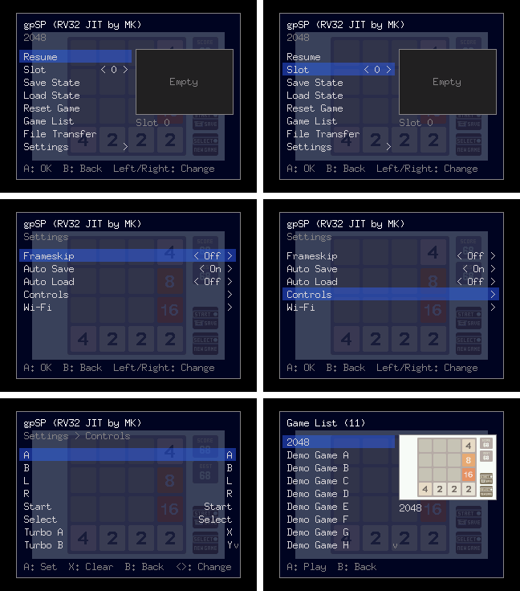
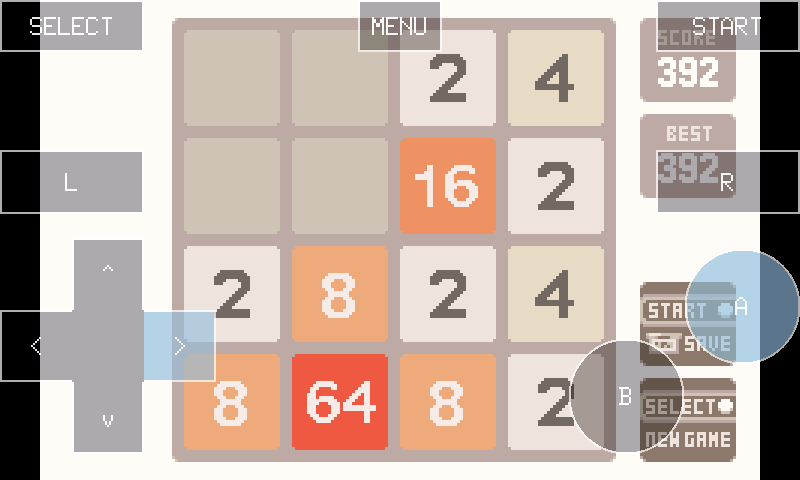

# gpSP ESP32

- Game Boy Advance emulator for ESP32, based on
  [gpSP](https://github.com/midworld/gpsp) with an RV32 JIT.
- P4 Nano and OSPTEK P4C5: LCD, speaker, USB gamepads, SD card games and
  save states, and Wi-Fi file transfer.



## Boards

| `GPSP_BOARD` | Default hardware support |
| --- | --- |
| `p4_nano` (default) | ST7789 SPI LCD, speaker, USB gamepads, SD card |
| [`osptek_p4c5`](boards/osptek_p4c5/README.md) | 800x480 DSI LCD, touch controls, speaker, USB gamepads, SD card |
| [`wt9932p4x_tiny`](boards/wt9932p4x_tiny/README.md) | Headless, USB Serial/JTAG, optional wired SD |
| [`esp32s31`](boards/esp32s31/README.md) | Experimental headless build, UART console, embedded ROM |
| `espemu` | Virtual Ethernet output to the [host viewer](tools/espemu-host/README.md) |

- Use a separate build directory and generated `sdkconfig` for each board.
- Board defaults and wiring are in `boards/<name>/`.

## Build

- Requires ESP-IDF v6.1.
- LCD, audio, and USB gamepad support are enabled by default on P4 Nano.
- Put `.gba` files in `roms/` on a FAT-formatted SD card.

```sh
idf.py -B build-p4 -D GPSP_BOARD=p4_nano \
  -D SDKCONFIG=build-p4/sdkconfig -D GPSP_ROM_PATH= menuconfig
idf.py -B build-p4 build
idf.py -B build-p4 -p PORT flash monitor
```

- Set `CONFIG_*` options in `menuconfig`; pass `GPSP_RV32_USE_*` as
  CMake flags, for example `-D GPSP_RV32_USE_ZCB=0`.
- An empty `GPSP_ROM_PATH` uses the SD card without generating a flash ROM
  image. To embed a ROM, set `-D GPSP_ROM_PATH=/path/to/game.gba`.
- Use `app-flash` for later code updates with the same partition layout.
- For OSPTEK P4C5:

```sh
idf.py -B build-osptek -D GPSP_BOARD=osptek_p4c5 \
  -D SDKCONFIG=build-osptek/sdkconfig -D GPSP_ROM_PATH= build
idf.py -B build-osptek -p PORT flash monitor
```

| Flag | Purpose | Default |
| --- | --- | --- |
| `CONFIG_GPSP_LCD` | LCD output | On for P4 Nano |
| `CONFIG_GPSP_MENU` | In-game menu | On when LCD is enabled, except in benchmark builds |
| `CONFIG_GPSP_AUDIO` | Speaker output | On for P4 Nano |
| `CONFIG_GPSP_USB_PAD` | USB gamepad input | On for P4 Nano, except in benchmark builds |
| `CONFIG_GPSP_USB_BT` | USB Bluetooth adapter and Classic HID gamepads | On for OSPTEK P4C5 |
| `CONFIG_GPSP_CARTRIDGE_AUTOSAVE` | Cartridge save loading and periodic saving | Off |
| `GPSP_RV32_USE_RVC`, `GPSP_RV32_USE_ZBA`, `GPSP_RV32_USE_ZBB`, `GPSP_RV32_USE_ZBS`, `GPSP_RV32_USE_ZCB` | JIT instruction extensions, individually selectable | All `1` on P4 and S31 |
| `CONFIG_GPSP_AFFINE_PIE` | XespV affine rendering | On for physical P4; off for virtual builds |
| `CONFIG_GPSP_RV32_ROM_CACHE_KIB`, `CONFIG_GPSP_RV32_RAM_CACHE_KIB` | ROM/RAM JIT cache limits | 2048 KiB each |
| `CONFIG_GPSP_RV32_CODE_CHUNK_KIB` | JIT cache allocation chunk | 256 KiB |
| `CONFIG_GPSP_ROM_BUFFER_SIZE` | ROM data buffer limit, in MiB | `0`: 4 MiB for PSRAM ≤16 MiB; 8 MiB above 16 MiB |
| `CONFIG_GPSP_BENCHMARK` | Fixed-frame benchmark logging | Off |
| `CONFIG_GPSP_PERFORMANCE_DIAGNOSTICS` | Detailed frame checksums and performance logs | Off on physical boards |
| `CONFIG_GPSP_SD_SINGLE_BLOCK_WRITES` | Single-block SD writes from boot | On for OSPTEK P4C5 |

## Controls and display

- USB input supports Xbox, Switch Pro, DualShock 4, and DualSense gamepads.
- USB Bluetooth adapters support Bluetooth Classic HID gamepads.
  Pair a controller in Settings > Bluetooth.
- OSPTEK touch controls work in games and menus. Enable Virtual Pad in
  Settings, or double-tap the screen while it is off. Pad opacity is
  25%, 50%, or 100%; physical button mappings remain independent.

  

  Test-model render, with A and Right pressed at 100% pad opacity.
  [2048 Advance](https://basil-termini.itch.io/2048-advance) by Basil Termini
  ([CC0 1.0](https://github.com/Paperdomo101/2048-GBA/blob/ae36800dfa1314f96c4c8785b5c2d077fb731aff/LICENSE)).

- DSI output offers Nearest, Bilinear, and LCD Grid filters, an optional
  GBA color profile, and Off/Simple/Full Stats modes.
- The menu saves mute separately from volume. OSPTEK enables a 300 Hz
  speaker high-pass filter by default.
- SD transfers retry once after a timeout. Failed recovery or a second
  timeout disables card access until restart. OSPTEK uses single-block
  writes from boot.
- The host viewer displays games and menus and supports screenshot
  commands. See [host setup](tools/espemu-host/README.md).
- Validation projects are in `tests/`; display checks are documented in
  [DSI checks](tests/p4-nano-dsi-check/README.md).

## Performance

- Reference P4 Nano measurements:
- P4 Nano at 400 MHz, 32 MiB PSRAM at 200 MHz,
  LCD and speaker on, Wi-Fi and frameskip off.
- JIT cache: 256 KiB chunks and 2 MiB limits each for ROM/RAM;
  ROM data buffer: 8 MiB.

| Game | Mean frame (ms) | Worst frame (ms) | FPS | One-core load | ROM cache (KiB) | RAM cache (KiB) |
| --- | ---: | ---: | ---: | ---: | ---: | ---: |
| DOOM II | 13.07 | 23.98 | 59.73 | 78.1% | 293.3 / 512 | 674.2 / 768 |
| Asterix & Obelix XXL | 12.26 | 20.47 | 60.02 | 73.6% | 461.1 / 512 | 1295.7 / 1536 |
| Metroid Fusion | 13.17 | 14.23 | 59.78 | 78.7% | 63.9 / 256 | 34.5 / 256 |
| Mario Kart: Super Circuit | 10.50 | 11.53 | 59.84 | 62.8% | 74.1 / 256 | 11.8 / 256 |

- Frame time excludes pacing waits; FPS includes them. Cache values are
  JIT code **used / allocated**.
- OSPTEK display measurements and benchmark workflows:
  [benchmark notes](docs/benchmark.md).
